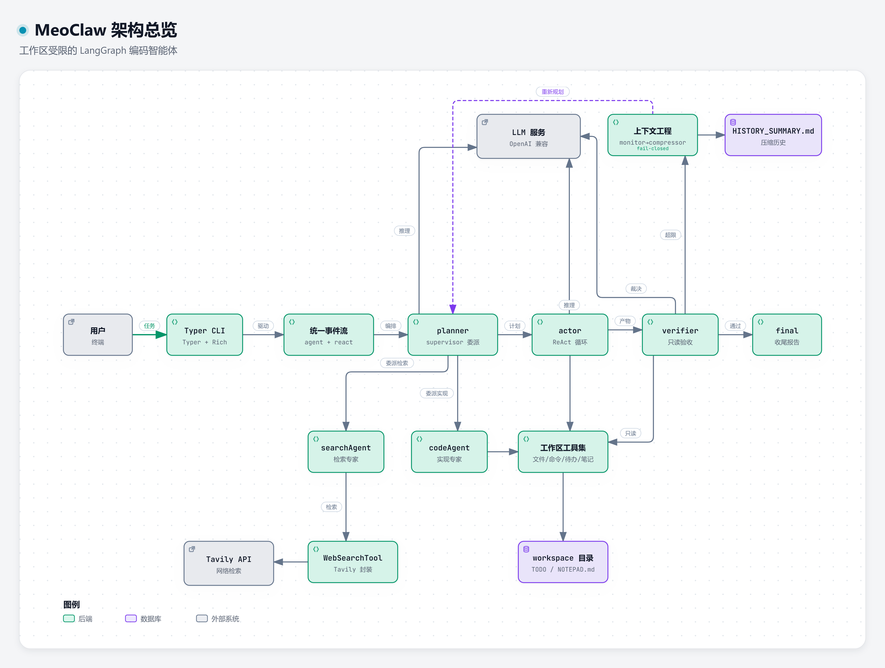

# MeoClaw

一个本地桌面 AI 助理：Electron + React 前端、Python 桥接服务、MeoClaw Agent 后端核心三位一体。
支持纯对话、工作区文件任务和系统工具（截图/剪贴板/打开链接）三类权限模式，高危操作需用户批准。

> 仓库分支说明：**`main`** 为桌面端工程（`desktop/` 前端 + `bridge/` 桥接层）；
> **`branch`** 为后端核心 `meoclaw`（planner→actor→verifier 工作流、工具集、CLI、测试）。



## 项目整体架构

| 层 | 位置 | 技术 | 职责 |
| --- | --- | --- | --- |
| 桌面壳 | `desktop/electron/` | Electron 33 | 拉起/复用桥接进程、创建窗口、无系统菜单 |
| 渲染层 | `desktop/src/` | React 18 + TypeScript + Vite | 会话侧边栏、消息流、执行过程卡、审批卡、输入卡片、设置弹窗 |
| 桥接层 | `bridge/meoclaw_bridge/` | FastAPI + uvicorn + websockets | 仅监听 `127.0.0.1:8931`，REST + WS 封装后端事件流，会话持久化与密钥管理 |
| 后端核心 | `branch` 分支 `src/meoclaw/` | langgraph + langchain | `stream_agent_events` / `stream_react_events` 事件流、工作区路径安检 |

一次任务的数据流：

```
输入消息 → POST /api/task（懒建会话、用户消息落库、后台线程启动）
        → WS /ws/task/{id} 推事件（node_start / plan / tool_call / tool_result /
          verification / final_answer / approval_request / ui_done）
        → final_answer 自动落库为助手消息 → 侧边栏刷新会话标题
```

## 目录结构与模块职责

```
.
├─ bridge/meoclaw_bridge/     # Python 桥接服务
│  ├─ server.py               # FastAPI 入口：REST 端点 + WS 事件泵
│  ├─ config.py               # settings.json 读写、keyring 密钥、供应商解析
│  ├─ store.py                # SQLite 会话/消息持久化（懒创建）
│  └─ adapters/
│     ├─ runner.py            # 三模式后台执行 + HITL 审批注册表
│     ├─ model_factory.py     # 由激活供应商构造 ChatOpenAI、测试连接
│     └─ system_tools.py      # 系统工具集（5 个，高危需批准）
├─ desktop/                   # Electron + React 前端
│  ├─ electron/main.cjs       # 主进程：桥接子进程管理、窗口、去菜单
│  ├─ electron/preload.cjs    # 仅暴露 bridgePort
│  └─ src/                    # App.tsx + api.ts + components/ + styles.css
├─ structure_viewer/          # 后端核心交互式架构图（见其 README.md）
└─ requirements.txt           # 桥接层 Python 依赖
```

## 关键类与函数

### 桥接层（bridge）

| 接口 | 说明 |
| --- | --- |
| `GET /api/health` | 健康检查（Electron 启动前探测/复用） |
| `GET /api/sessions`、`GET /api/sessions/{sid}/messages`、`DELETE /api/sessions/{sid}` | 会话与消息 |
| `GET/POST /api/settings` | 读写 `temperature / max_attempts / permission / sidebar_open` |
| `POST /api/providers`、`DELETE /api/providers/{name}`、`POST /api/providers/active` | CC Switch 式供应商管理 |
| `POST /api/test-connection` | 用表单参数（或已存密钥）试调模型 |
| `POST /api/task` | 启动任务，返回 `{task_id, session_id}` |
| `POST /api/approval/{aid}` | 审批放行/拒绝 |
| `WS /ws/task/{tid}` | 推送 runner 事件流，`ui_done` 收尾 |

- `runner.start(mode, task, settings, session_ws, history)` → 事件队列；`chat` 直连模型流式对话，`workspace` 调 `stream_agent_events`，`system` 调 `stream_react_events` + 系统工具
- `Approvals.request(tool, detail, timeout=120)`：工具线程挂起等待 UI 批准，超时视为拒绝
- `system_tools`：`TakeScreenshot / ClipboardRead / ClipboardWrite / OpenUrl / OpenWorkspaceFile`，路径经 `resolve_in_workspace` 安检，越界直接拒绝
- `store`：会话仅在首条消息时落库，标题取首条消息前 60 字

### 前端（desktop/src）

- `App.tsx`：全局状态中枢；`handleEvent()` 将事件流映射为进度步骤/流式文本/审批卡；Ctrl+B 切换侧边栏；权限档位即时持久化
- `api.ts`：REST 封装 + `taskSocket()`；端口取 `window.meoclaw.bridgePort`（纯浏览器调试回落 8931）
- 组件：`Sidebar`（品牌+新会话+历史）、`ChatView`（欢迎屏/消息流）、`Composer`（输入卡片+权限下拉，无模型选择器）、`ProgressCard`（可折叠执行过程）、`ApprovalCard`（允许/拒绝）、`SettingsModal`（供应商与运行参数）
- `styles.css`：黑白浅色主题（主色 `#171717`，无彩色）

## 技术栈

| 技术 | 版本要求 | 项目中用途 | 选用理由 |
| --- | --- | --- | --- |
| Electron | ≥ 33 | 桌面壳、桥接进程管理 | Web UI 快速落地，`contextIsolation` 安全模型 |
| React + TypeScript | 18 / 5 | 渲染层 | 事件流驱动的组件化 UI |
| Vite | ≥ 5 | 开发服务器与构建 | 秒级热更新，`base:"./"` 支持 file:// 加载 |
| FastAPI + uvicorn | ≥ 0.115 / 0.30 | 桥接 REST/WS | 与后端同语言零转换，自动文档 |
| websockets | ≥ 12 | 事件流传输 | 单向推送即可，断线即任务结束 |
| langchain-openai / core | ≥ 0.2 / ≥ 0.3 | 模型接入与工具协议 | OpenAI 兼容网关换供应商零改动 |
| keyring | ≥ 25 | API Key 存 Windows 凭据管理器 | 失败自动降级本地 `.secrets.json` |
| pyperclip / Pillow | — | 剪贴板与截图系统工具 | 桌面场景刚需 |
| meoclaw（branch 分支） | — | 后端工作流编排 | 复用 langgraph 状态图与统一事件流 |

## 依赖关系

```
desktop(渲染层) ──HTTP/WS──▶ bridge(8931) ──pip -e──▶ meoclaw 核心(branch)
                                │                        │
                                ▼                        ▼
                    %APPDATA%\MeoClawDesktop        OpenAI 兼容 API
                    settings.json / store.db /      (.env 或设置页供应商)
                    sessions\<sid>\ 工作区
```

- 前端不接触任何后端逻辑与密钥，仅访问本机 8931
- 每个会话有独立工作区目录，文件操作被限制在其中

## 快速开始

```powershell
# 1) 后端核心（branch 分支）+ Python 依赖（建议独立 venv，如 pyruntime）
git clone -b branch https://github.com/Iivresse1/MeoClaw.git meoclaw-core
cd meoclaw-core
python -m venv ..\pyruntime
..\pyruntime\Scripts\python.exe -m pip install -e ".[dev]"
..\pyruntime\Scripts\python.exe -m pip install -r ..\MeoClaw-Desktop\requirements.txt

# 2) 前端依赖
cd ..\MeoClaw-Desktop\desktop
npm install

# 3) 运行（Electron 自动拉起或复用桥接服务，端口 MEOCLAW_BRIDGE_PORT，默认 8931）
npm run dev                 # 开发模式（vite 热更新）
npm run build; npm start    # 生产模式（加载 dist）
```

首次启动后打开「设置」添加模型供应商即可开始对话。

## 配置

**模型供应商（设置页，CC Switch 式）**：名称 / 模型名 / Base URL / API Key 多条记录，
`active_provider` 一键切换当前供应商；密钥存 keyring（服务名 `MeoClawDesktop`，
键名 `provider:{名称}`），不可用时降级 `%APPDATA%\MeoClawDesktop\.secrets.json`。

**`%APPDATA%\MeoClawDesktop\settings.json`**：

| 字段 | 默认 | 说明 |
| --- | --- | --- |
| `temperature` | `0.0` | 采样温度 |
| `max_attempts` | `3` | workspace 模式最大验证轮数 |
| `permission` | `workspace` | 输入框权限档位记忆 |
| `providers` / `active_provider` | `[]` / `""` | 供应商列表与当前项 |
| `sidebar_open` | `true` | 侧边栏开合状态 |

## 权限模式

| 下拉文案 | 内部值 | 行为 |
| --- | --- | --- |
| 仅对话 | `chat` | 直连模型流式对话，携带会话历史 |
| 在工作区内修改 | `workspace`（默认） | planner→actor→verifier→final 完整工作流，文件操作限于会话工作区 |
| 系统工具（需批准） | `system` | ReAct 循环 + 5 个系统工具，高危操作弹审批卡（120 秒未处理视为拒绝） |

## 测试

- 后端核心全链路回归（假模型、无需 API Key）在 `branch` 分支运行：`python -m pytest`
- 桌面端冒烟：`GET /api/health` 探活 → 发送一条「仅对话」消息验证事件流与消息落库 →
  `system` 档触发审批卡验证允许/拒绝链路

---

> 后端核心的完整架构、模块职责、关键类与函数、事件系统、安全模型与扩展指南见
> [项目架构指南.md](https://github.com/Iivresse1/MeoClaw/blob/branch/项目架构指南.md)；
> 交互式分层架构图（模块级 → 函数级 → 代码行级下钻）见 [structure_viewer/](structure_viewer/README.md)。
